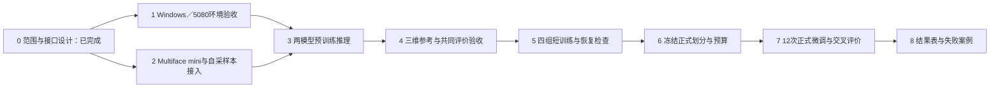

# SMIRK、DECA 在自采数据与 Multiface 上的实验实施方案

## 1. 第一阶段范围与当前条件

目标：实现两个模型 × 两个训练来源的微调实验，并将所有训练组交叉评价于相同的 A、B 未见人物测试集。

- A：自采数据，正在采集，尚未读取真实样本。
- B：Multiface，尚未下载。先用 mini 验证接入，再选择正式人物与资产；mini 不作为正式泛化实验规模。
- 运行机器：另一台 Windows 电脑，单张 RTX 5080；用户报告内存 64 GB，实际 GPU 显存待确认。
- 本机负责开发与打包；训练需在目标机器执行。已建立独立 CPU 验证环境测试公共工具和训练状态恢复，尚未访问目标机器或运行真实模型。
- 2026-10-27 已核查官方训练文档、SMIRK 配置与入口、DECA 数据读取代码、Multiface 目录说明，以及工作区保存的旧采集程序快照。该快照不能代表正在使用的采集程序版本。

## 2. 实验矩阵

| 编号 | 模型 | 训练来源 | 测试集 |
| --- | --- | --- | --- |
| R0-S | SMIRK 官方预训练权重 | 无本地微调 | 同一份 A-test、B-test |
| R0-D | DECA 官方预训练权重 | 无本地微调 | 同一份 A-test、B-test |
| R1 | SMIRK | A-train | 同一份 A-test、B-test |
| R2 | SMIRK | B-train | 同一份 A-test、B-test |
| R3 | DECA | A-train | 同一份 A-test、B-test |
| R4 | DECA | B-train | 同一份 A-test、B-test |

先用单个随机种子确认完整流程，再运行 3 个配对随机种子，正式微调共 12 次。两模型按顺序占用单张 GPU。每个模型内部固定初始化、训练目标、更新范围、有效 batch 与训练步数；模型间允许使用各自配方。记录抽样人次、有效训练图像数、实际耗时和显存峰值。

主线先完成共同图像监督的微调：输入 RGB，离线提取模型需要的二维关键点、人脸掩码等。该实验用于比较 RGB 训练数据的效用。三维点位与网格作为独立资产保留；三维参考通过核验后用于评价。使用自采点位进行监督属于后续明确标注的适配实验，不能悄悄混入主表。

若要比较两套数据的几何监督效用，需另加共同语义点监督配置：从 A 标记及 B 网格建立可核验的对应，统一单位、掩码、损失和权重。自采标记表面与网格皮肤表面的位置差异也需处理。未建立对应时不启动该组。

## 3. 环境方案

建议在目标 Windows 机器上使用 WSL2＋Ubuntu，SMIRK、DECA 分别使用独立环境。先验证 RTX 5080 的 CUDA 张量运算、可微渲染前向／反向，再锁定 Python、PyTorch、CUDA 工具链、PyTorch3D 与上游提交号。

SMIRK 原说明的 Python 3.9／CUDA 11.7 组合不能直接作为本机器安装方案。PyTorch 2.7 已引入 Blackwell 与 CUDA 12.8 支持，可以作为兼容性排查依据；最终组合仍需两套模型和渲染扩展实测。仅能导入 PyTorch 或识别 GPU 不等于训练环境验收通过。

DECA 的 coarse／detail 阶段分开配置。优先完成 coarse 几何实验并固定 detail 使用方式；动态点位评价不足以单独证明皱纹细节改善。SMIRK 的重建、循环路径和生成器加载状态需完整记录，不能将仅加载编码器的简化训练称作官方完整训练。

## 4. 代码结构设计

初版 v0.1 已实现独立 Python 包，实际结构如下。真实模型与授权资产在目标机器按需准备；所有模块的测试边界详见工程 README。

```text
face_reconstruction_benchmark/
  docs/                    实施方案、安装说明、进度与运行记录
  configs/                 本机路径、模型配方、实验分组、随机种子
  environments/            Windows 信息检查、WSL2 候选安装与环境依赖
  third_party/             官方代码，固定提交；模型授权资产不随代码打包
  src/facebench/
    io.py                  清单、配置与哈希存档
    data.py                两来源索引、划分、审计与等额抽样
    preprocessing.py       FAN／MediaPipe、裁剪、掩码和失败清单
    models.py              SMIRK 双路径与 DECA coarse 适配
    geometry.py            固定变换、重心对应、KRT／OBJ 读取
    evaluation.py          点误差、位移／速度函数、人物宏平均
    experiments.py         分组配置、训练、验证、恢复和推理导出
    tools.py               环境检查、原始点位导出、网格到标记转换
    cli.py                 统一命令入口
  scripts/                 审计、准备、预训练推理、短训练、正式运行、汇总入口
  tests/                   数据隔离、坐标变换、指标和恢复流程检查
  outputs/                 训练日志、权重、预测、可视化和结果表
```

上游模型使用适配层连接，保留各自训练机制。统一的是原始数据索引、划分、预算与结果协议；不强迫两个模型共享完全相同的训练数据字典。代码与运行产物存入专用目录，原始数据通过配置引用并保持只读。

## 5. 统一数据接口

| 字段 | 作用 | 要求 |
| --- | --- | --- |
| sample_id、dataset_id | 唯一样本与来源标识 | 必需 |
| subject_id、session_id、sequence_id、camera_id | 按人划分、同人采样与跨视角关联 | 必需；名字由读取器标准化 |
| image_path 或 video_path＋frame_index | 定位 RGB 图像 | 必需；不要求先把所有视频转为图片 |
| rgb_timestamp、timestamp_unit、clock_domain | 对齐 RGB 与三维参考 | 三维评价必需，不能只依赖 MP4 标称帧率 |
| bbox、crop_transform、landmarks_2d、face_mask | 模型预处理及像素位置转换 | 可自动生成；先记录原图坐标再变换 |
| points_3d、point_ids、point_valid、point_timestamp | 自采标记与时序有效性 | 几何监督／评价使用；原始观测与插值平滑结果分开 |
| mesh_path、headpose_path | Multiface 几何参考 | 按计划下载；不等同于模型输入 |
| intrinsics、extrinsics、distortion、units、coordinate_frame | 空间转换与投影 | 几何评价必需；禁止猜测单位或轴方向 |
| neutral_reference、point_to_surface_map | 局部位移与固定点对应 | 相关评价使用；校准段与计分测试段区分 |
| source_version、quality_flags | 来源与失败追踪 | 保存采集版本、处理版本和无效原因 |

SMIRK 实际输入为其所需的人脸图像与辅助监督，官方训练预处理包括 FAN、MediaPipe。DECA 读取 image、landmark、mask，并支持同一人物的 K 张图像分组。统一索引需保留身份与序列信息；训练中不能把任意不同人物凑成同人组。

## 6. 实施进度线



| 阶段 | 当前状态 | 完成标准 | 依赖 |
| --- | --- | --- | --- |
| 0 范围与接口 | 已实现初版工程 | 明确四组训练、双测试集、数据字段及交付边界 | 本方案 |
| 1 环境验收 | 检查与候选安装脚本已写；待目标机验证 | CUDA 运算、渲染梯度、模型前后向正常，锁定版本并留日志 | Windows／WSL2、显存、驱动信息及模型资产 |
| 2 数据接入 | 读取／划分／审计已写并有构造数据测试；待真实数据联调 | 两来源可审计、按人索引；RGB 与点位可对齐预览；无缺失字段被静默补零 | 自采短样本、Multiface mini |
| 3 预训练推理 | 适配与导出已写；未跑真实模型 | 两模型在两来源输出网格、参数和叠加预览，记录失败 | 阶段 1、2 |
| 4 共同评价 | 稀疏点评价与数值检查已完成；真实对应待核验 | 核验单位、坐标、固定点对应和同步；同组都在固定参考上评分 | 标记布局、标定、中性段、Multiface 几何 |
| 5 短训练 | 调度和状态恢复通过 CPU 小网络测试；真实四组待运行 | 四组均有有限损失、有效梯度和参数更新；保存后能恢复，记录资源用量 | 阶段 1–3；正式计分依赖阶段 4 |
| 6 正式协议冻结 | 分组模板已生成工具；待数据规模确认 | 按人划分；A/B 预算、验证选模、指标与失败策略固定 | 正式人物清单；mini 无法替代 |
| 7 正式训练 | 未启动 | 2 模型×2 来源×3 种子，逐组保存配置、权重及测试输出 | 阶段 4–6 |
| 8 汇总 | 未启动 | 分测试集、按人物汇总；结果均值与波动、可视化及失败案例齐全 | 阶段 7 |

阶段 1 与阶段 2 可并行推进；首次一人短片只用于接入，不用于证明未见人物泛化。暂不承诺训练时长与 batch 大小，待短训练测得显存与吞吐后确定。

v0.1 先支持 DECA coarse 微调和稀疏几何评价。自动稠密表面评价、DECA detail 微调及全部消融尚未实现。共享验证选模先使用二维关键点 MAE，不冒充三维主评价指标。详见 [工程运行说明](../README.md)。

## 7. 用户需要提供的信息

第一批只需：Windows 版本、显存与可用磁盘、WSL2 状态；一段自采短样本的实际目录与字段样例；FLAME、SMIRK、DECA 资产准备状态。未知项可以留空。

自采样本建议包含同一段 10–30 秒 RGB、该段原始三维点位、每帧时间记录、标定文件、参与者和任务编号、标记位置说明。若尚未生成三维点位，可以先提供原始采集目录及当前采集程序版本。无需先整理成模型格式，也无需先手工提取 FAN／MediaPipe。

已收到用户提供的点位示意图，其中人脸部分标为 F01–F32，计划共 32 点，覆盖额头、眉部、眼周、鼻部、脸颊、口周和下颌。图本身注明属于工程示意，实际贴点数量与位置仍以真人采集记录为准；不能据此认定已获得 32 条稳定三维轨迹。颈部及装置参考点与人脸点分开登记。


图：用户提供的采集界面与标记布局截图。F01–F32 作为计划物理标记编号；具体解剖位置、左右方向及实际贴点偏差需结合采集记录确认。

适配器需要分别保存程序的 track_id 与物理 marker_id。若程序只输出数字轨迹 ID，需增加经核验的对应表；不能默认第 1 条轨迹就是 F01，或按每帧列表顺序赋予 F 编号。模型表面到物理标记的对应使用固定校准协议建立。32 个采集标记与 FAN／MediaPipe 关键点属于不同体系，不能直接互相替换。

正式实验前再补：总人数、每人 session 和任务量、正式标记布局、track ID 是否稳定对应物理标记、点位缺失与平滑处理规则、RGB 与 IR／三维点的同步方式、中性校准段、当前可用的三维参考范围。

Multiface 尚未下载，后续先按官方 mini 配置接入。正式实验选择与 A 可比较的动作和视角，并下载 RGB、元数据、网格和头姿。暂不以全量 65 TB 为下载目标；UV／音频是否需要由实际训练配方决定。

## 8. 本次核查依据

- [SMIRK 官方训练与预处理说明](https://github.com/georgeretsi/smirk/blob/main/readme.md)
- [SMIRK 训练配置](https://github.com/georgeretsi/smirk/blob/main/configs/config_train.yaml)
- [DECA 官方训练说明](https://github.com/yfeng95/DECA)
- [DECA 数据字典与同人分组读取](https://github.com/yfeng95/DECA/blob/master/decalib/datasets/vggface.py)
- [Multiface 目录与格式](https://github.com/facebookresearch/multiface/blob/main/documentation/DATA_STRUCTURE.md)
- [Multiface 下载流程](https://github.com/facebookresearch/multiface)
- [PyTorch 2.7 Blackwell 与 CUDA 12.8 支持](https://pytorch.org/blog/pytorch-2-7/)
- [PyTorch3D 安装及编译说明](https://github.com/facebookresearch/pytorch3d/blob/main/INSTALL.md)
- [Microsoft：WSL 中使用 NVIDIA CUDA](https://learn.microsoft.com/en-us/windows/ai/directml/gpu-cuda-in-wsl)
